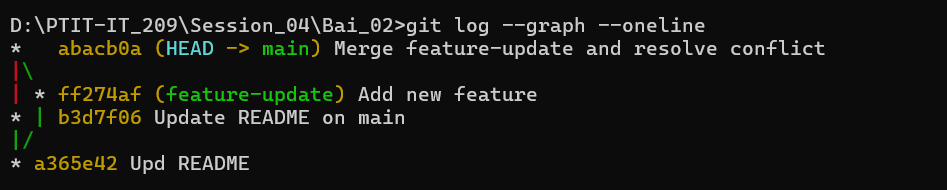

# Bài 2: Quản lý nhánh và Giải quyết xung đột (Merge Conflict)

## 1. Mục tiêu

- Tạo mới và di chuyển giữa các nhánh Git.
- Phát triển tính năng trên nhánh `feature-update`.
- Đồng thời cập nhật nhánh `main`.
- Cố ý tạo Merge Conflict trên cùng file `README.md`.
- Giải quyết xung đột thủ công.
- Hoàn thành Merge Commit và kiểm tra lịch sử bằng `git log --graph --oneline`.

---

## 2. Môi trường thực hiện

- Hệ điều hành: Windows
- Công cụ: Git, Command Prompt (CMD)
- Thư mục thực hiện:

```text
D:\PTIT-IT_209\Session_04\Bai_02
```

- Nhánh chính: `main`
- Nhánh tính năng: `feature-update`

---

## 3. Quá trình tạo và cập nhật các nhánh

### Bước 1: Tạo nhánh `feature-update`

Từ nhánh `main`, tạo và chuyển sang nhánh tính năng:

```bash
git checkout -b feature-update
```

Sau đó cập nhật file `README.md` với nội dung:

```text
Tính năng mới được phát triển trên feature-update.
```

Commit thay đổi:

```bash
git add README.md
git commit -m "Add new feature"
```

Kết quả:

```text
[feature-update ff274af] Add new feature
```

### Bước 2: Cập nhật nhánh `main`

Chuyển về nhánh chính:

```bash
git checkout main
```

Trên `main`, thay đổi cùng phần nội dung trong `README.md` thành:

```text
Phiên bản chính thức được cập nhật trên main.
```

Commit thay đổi:

```bash
git add README.md
git commit -m "Update README on main"
```

Kết quả:

```text
[main b3d7f06] Update README on main
```

---

## 4. Tạo Merge Conflict

Thực hiện merge nhánh `feature-update` vào `main`:

```bash
git merge feature-update
```

Git phát hiện hai nhánh cùng thay đổi nội dung trong `README.md` và thông báo:

```text
Auto-merging README.md
CONFLICT (content): Merge conflict in README.md
Automatic merge failed; fix conflicts and then commit the result.
```

Đây là Merge Conflict theo đúng yêu cầu của bài.

---

## 5. Giải quyết Merge Conflict thủ công

Mở file `README.md` và kiểm tra các ký hiệu Git chèn vào:

```text
<<<<<<< HEAD
Phiên bản chính thức được cập nhật trên main.
=======
Phiên bản ban đầu của dự án.
Tính năng mới được phát triển trên feature-update.
>>>>>>> feature-update
```

### Cách xử lý

- `<<<<<<< HEAD`: đánh dấu phần nội dung của nhánh hiện tại `main`.
- `=======`: phân cách giữa hai phiên bản.
- `>>>>>>> feature-update`: đánh dấu phần nội dung của nhánh `feature-update`.
- Kiểm tra hai phiên bản và chọn nội dung cần giữ.
- Xóa thủ công toàn bộ các ký hiệu `<<<<<<<`, `=======`, `>>>>>>>`.

Nội dung cuối cùng của `README.md` sau khi giải quyết:

```text
# Bài 2: Quản lý nhánh và Giải quyết xung đột (Merge Conflict)
Phiên bản chính thức được cập nhật trên main.
Tính năng mới được phát triển trên feature-update.
```

Sau khi sửa xong, đánh dấu file đã giải quyết Conflict:

```bash
git add README.md
```

Kiểm tra:

```bash
git status
```

Git xác nhận:

```text
All conflicts fixed but you are still merging.
```

---

## 6. Hoàn thành Merge

Tạo Merge Commit:

```bash
git commit -m "Merge feature-update and resolve conflict"
```

Kết quả:

```text
[main abcb0a] Merge feature-update and resolve conflict
```

Như vậy Merge Conflict đã được giải quyết thủ công và quá trình merge đã hoàn thành.

---

## 7. Kiểm tra lịch sử commit

Sử dụng lệnh theo yêu cầu:

```bash
git log --graph --oneline
```

Lịch sử commit thu được:

```text
*   abcb0a (HEAD -> main) Merge feature-update and resolve conflict
|\
| * ff274af (feature-update) Add new feature
* | b3d7f06 Update README on main
|/
* a365e42 Upd README
```

Đồ thị cho thấy:

- `feature-update` tách ra từ commit chung.
- `feature-update` có commit `Add new feature`.
- `main` có commit `Update README on main`.
- Hai nhánh xảy ra xung đột khi merge.
- Sau khi giải quyết Conflict thủ công, hai nhánh được hợp nhất bằng Merge Commit `abcb0a`.

---

## 8. Kiểm tra Merge Commit có hai parent

Có thể kiểm tra bằng:

```bash
git log --oneline --parents -1
```

Merge Commit có hai commit cha, tương ứng với hai nhánh `main` và `feature-update`. Đây là cơ chế Merge 3-Way của Git.

---

## 9. Hình chụp lịch sử commit

Ảnh chụp kết quả chạy:

```bash
git log --graph --oneline
```

được đặt cùng thư mục với file `README.md` và chèn vào báo cáo với tên:

```text
merge-history.png
```

